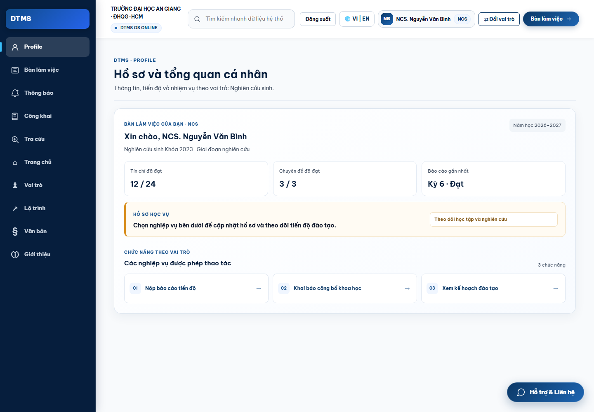

# DTMS — Hệ thống quản lý học vụ sau đại học

Frontend quản lý đào tạo sau đại học tại Trường Đại học An Giang, ĐHQG-HCM. Dự án sử dụng HTML, CSS và JavaScript thuần, gồm 10 màn hình và 14 phân hệ nghiệp vụ. Các luồng hiện có tập trung vào đào tạo tiến sĩ.



[Xem giao diện trên màn hình nhỏ](docs/screenshots/profile-mobile.png).

## Chạy dự án

Cài Node.js 18 trở lên, sau đó chạy tại thư mục dự án:

```sh
node scripts/serve.cjs
```

Mở [http://127.0.0.1:4173](http://127.0.0.1:4173). Chọn cổng khác: `node scripts/serve.cjs 4174`.

Nếu máy có npm, dùng `npm start`. Frontend không cần cài thư viện để chạy và không có bước build. Nên dùng HTTP server khi phát triển để kiểm tra route và kết nối API nhất quán.

## Chức năng

- Hồ sơ cá nhân và bàn làm việc theo 7 vai trò: nghiên cứu sinh, người hướng dẫn, Bộ môn, Khoa, Phòng Đào tạo, Ban Giám hiệu và Hội đồng.
- Quản lý hồ sơ nghiên cứu sinh, kế hoạch đào tạo, phân công hướng dẫn, học phần và bảng điểm.
- Nộp và đánh giá tiểu luận, đề cương, chuyên đề, báo cáo tiến độ, công bố khoa học và luận án.
- Theo dõi điều kiện bảo vệ, lưu chiểu, thông tin cấp bằng và biến động học vụ.
- Thông báo, danh mục luận án, tra cứu văn bằng, báo cáo CSV, sao lưu JSON và lịch sử thao tác.
- Tìm kiếm, lọc, sắp xếp, phân trang; kiểm tra dữ liệu biểu mẫu; hỗ trợ VI/EN, bàn phím và màn hình nhỏ.

## Cấu trúc mã nguồn

```text
index.html          Giao diện chính và các hộp thoại
assets/             Ảnh, biểu tượng và tài nguyên giao diện
css/                Style dùng chung, trang và responsive
js/core/            Router, cấu hình, HTTP client và ngôn ngữ
js/features/        Danh sách, thông báo, luận án và tra cứu
js/modules/         Quản lý học vụ và phân quyền giao diện
pages/              Điểm vào các trang, chuyển đến route tương ứng
scripts/            Server phát triển và công cụ kiểm tra
docs/               Tài liệu tích hợp, báo cáo và kết quả kiểm thử
```

Thứ tự nạp mã và quy ước được ghi tại [js/README.md](js/README.md). Các bản mã cũ được giữ để tham chiếu; entry point hiện tại chỉ nạp một bộ core/features/modules.

## Dữ liệu và kết nối hệ thống

Dữ liệu nghiệp vụ hiện lưu trên thiết bị bằng localStorage, khóa `DTMS_MANAGEMENT_APP_STATE_V2`, schema 3. Dự án có dữ liệu khởi tạo để tái hiện các luồng học vụ. Sao lưu JSON trước khi khôi phục dữ liệu hoặc chuyển máy.

Cơ chế truy cập hiện chọn hồ sơ bằng email và vai trò. Ví dụ hồ sơ khởi tạo: `nvbinh_ncs@agu.edu.vn`, `tvhuong@agu.edu.vn`, `pmdang_pdt@agu.edu.vn`. Xác thực mật khẩu, phiên máy chủ và kiểm quyền API cần backend triển khai. Không lưu mật khẩu hoặc secret vào frontend.

Tệp đính kèm hiện lưu tên, loại và kích thước; nội dung tệp cần dịch vụ upload/download. Email, chữ ký số, Turnitin và đồng bộ học vụ cần dịch vụ tương ứng. Giao diện giữ trạng thái chưa khả dụng khi dịch vụ chưa được cung cấp.

Cấu hình qua `window.DTMS_RUNTIME_CONFIG` trước khi nạp `js/core/config.js`. Xem [API-INTEGRATION.md](API-INTEGRATION.md) để biết endpoint, cấu trúc phản hồi và các API cần bổ sung. Dịch vụ xác minh văn bằng chỉ được bật sau khi backend đã trả kết quả kiểm chứng từ sổ gốc.

## Kiểm tra

Kiểm tra cú pháp và tài nguyên cục bộ, chỉ cần Node.js:

```sh
node scripts/check-source.cjs
```

Kiểm thử trình duyệt cần Playwright. Trên máy có npm:

```sh
npm install --no-save playwright
npx playwright install chromium
```

Giữ server đang chạy, sau đó mở terminal khác:

```sh
node scripts/check-all.cjs chromium
node scripts/check-profile-layout.cjs chromium
```

Có thể chọn `msedge`, `firefox`, `webkit`; cài browser tương ứng trước khi chạy. Đặt `DTMS_URL`, `DTMS_BROWSER`, `DTMS_FIREFOX_EXECUTABLE` khi cần. Các bài kiểm adapter dùng phản hồi API mô phỏng; nghiệm thu backend/database và Safari cần môi trường thực tế. Chi tiết tại [docs/TESTING.md](docs/TESTING.md).

## Tài liệu và đóng góp

- [Quy ước đóng góp](CONTRIBUTING.md)
- [Tiến độ và quyết định kỹ thuật](PROGRESS.md)
- [Danh sách vấn đề và trạng thái](TODO.md)
- [Hợp đồng tích hợp API](API-INTEGRATION.md)
- [Báo cáo rà soát ngày 18/10/2026](docs/BAO_CAO_HOAN_THIEN_FRONTEND_2026-10-18.md)

Các báo cáo có ngày tháng ghi lại trạng thái ở thời điểm lập báo cáo. Thay đổi sau bàn giao được cập nhật trong PROGRESS và TODO.
